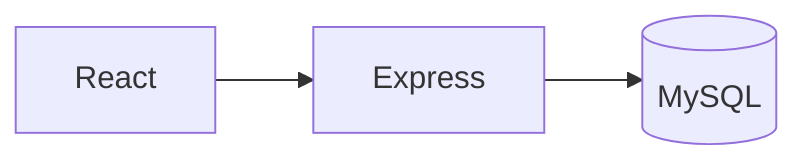

# Popilot

Cockpit de **pilotage de projets et de qualité** : processus, risques, audits, budget, tâches, équipe et comptes rendus.

<p align="center">
  
  
  
  
  
</p>

<p align="center">
  <strong>Dépôt :</strong> <a href="https://github.com/Meriem1403/Popilot">github.com/Meriem1403/Popilot</a>
</p>

---

## Sommaire

- [Présentation](#présentation)
- [Fonctionnalités](#fonctionnalités)
- [Stack technique](#stack-technique)
- [Architecture](#architecture)
- [Prérequis](#prérequis)
- [Installation](#installation)
- [Sécurité](#sécurité)
- [Structure du projet](#structure-du-projet)
- [Scripts disponibles](#scripts-disponibles)

---

## Présentation

Popilot rassemble sur un seul écran ce qu'une équipe projet consulte d'habitude dans plusieurs fichiers : le portefeuille, les processus, les risques, les audits, le budget et les réunions. Chaque vue a ses formulaires de création (projet, tâche, membre, poste, processus, réunion).

La pile tourne avec Docker : frontend Vite, API Express, base MySQL.

---

## Fonctionnalités

| Vue | Contenu |
|-----|---------|
| **Tableau de bord** | Synthèse personnelle et vue d'ensemble |
| **Projets** | Création, édition, pipeline |
| **Processus** | Cartographie et détail d'un processus |
| **Tâches** | Attribution et suivi |
| **Risques** | Registre des risques |
| **Audits** | Campagnes d'audit |
| **Budget** | Suivi budgétaire |
| **Équipe** | Membres, postes, fiches |
| **Réunions** | Ordre du jour et compte rendu |
| **Satisfaction** | Retours |
| **Veille et marketing** | Notes de veille et stratégie |
| **Documentation** | Pièces du projet |
| **Blocages** | Déclaration d'un point bloquant |
| **Calendrier** | Échéances |

---

## Stack technique

| Couche | Technologies |
|--------|----------------|
| Frontend | React, Vite, Radix UI |
| API | Node.js, Express (`backend/`) |
| Données | MySQL, client Supabase côté certaines vues |
| Conteneurisation | Docker Compose |

---

## Architecture



Les ports publiés sont ceux de `docker-compose.yml`.

---

## Prérequis

- **Docker** et Docker Compose
- **Git**

---

## Installation

```bash
git clone https://github.com/Meriem1403/Popilot.git
cd Popilot
docker compose up --build
```

Hors Docker :

```bash
npm install
npm run dev
```

Le frontend Vite et l'API doivent alors pointer vers une MySQL déjà démarrée. Le chemin le plus court reste le compose.

---

## Sécurité

- Pas de mot de passe de base dans Git. Les variables du compose restent locales.
- Les jeux marqués « test data » dans certains composants servent au développement, pas à une base de production.
- Ne pas importer un export client dans ce dépôt public.

---

## Structure du projet

```
Popilot/
├── src/components/        # Vues métier (projets, risques, audits…)
├── src/hooks/
├── src/data/
├── backend/src/           # API Express
├── docker-compose.yml
└── Dockerfile
```

---

## Scripts disponibles

| Commande | Description |
|----------|-------------|
| `npm run dev` | Frontend Vite |
| `npm run build` | Build de production |
| `docker compose up --build` | Frontend, API et MySQL |

---

<p align="center">
  <sub>Popilot — cockpit projets, processus, risques, audits et budget.</sub>
</p>
